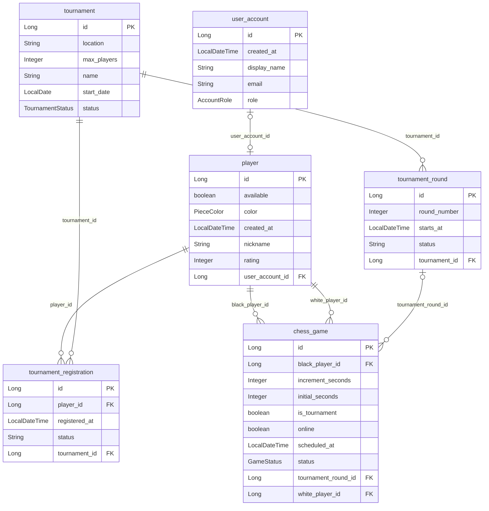

# Schemat bazy danych

Plik generują reguły projektu (panel Maven → Lifecycle → verify). Nie edytujcie go ręcznie.

Tabele: 6 · kolumny: 38 · relacje: 6 × @ManyToOne, 1 × @OneToMany, 1 × @OneToOne, 0 × @ManyToMany

| Tabela | Encja | Kolumny | Klucze obce |
|---|---|---|---|
| chess_game | ChessGame | 10 | black_player_id, tournament_round_id, white_player_id |
| player | Player | 7 | user_account_id |
| tournament | Tournament | 6 | — |
| tournament_registration | TournamentRegistration | 5 | player_id, tournament_id |
| tournament_round | TournamentRound | 5 | tournament_id |
| user_account | UserAccount | 5 | — |

